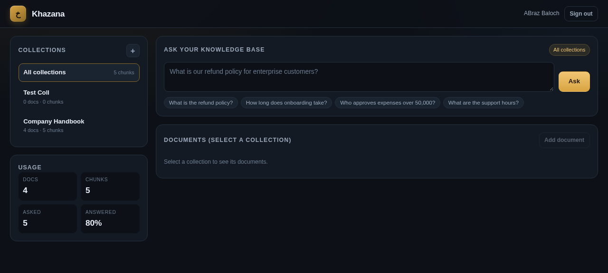
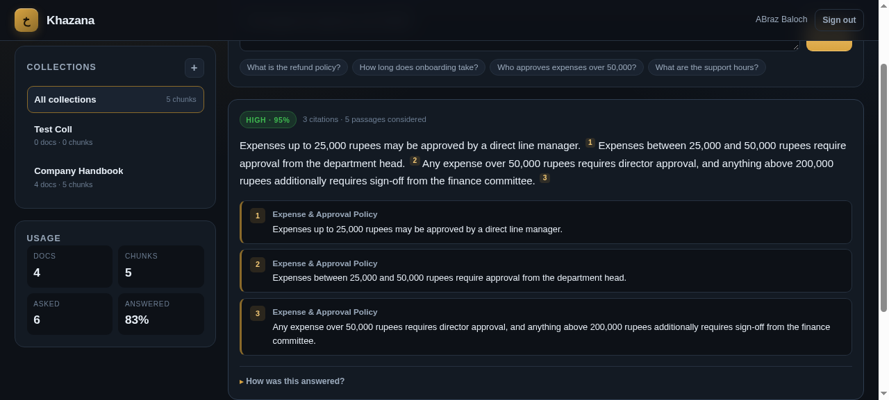
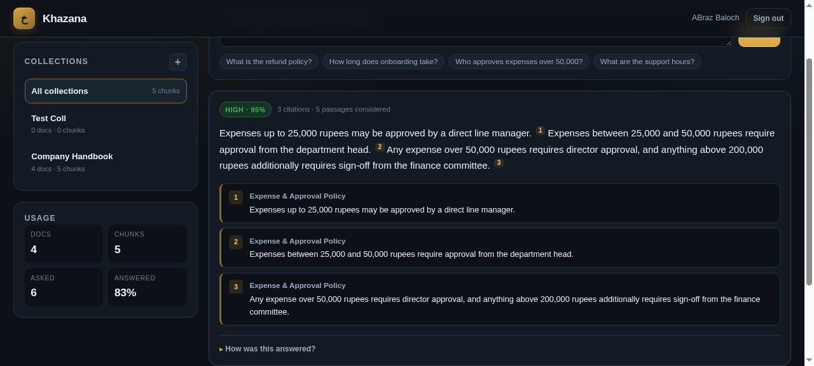

# Khazana · خزانہ

**A private knowledge base that answers with receipts.**

Ask a question about your own documents and get an answer built from the exact
sentences that support it — each one cited, each one traceable to a file and a
position in that file. When the documents don't cover the question, it says so
instead of inventing something.



---

## Why this exists

Every "chat with your docs" tool has the same failure mode: it answers
confidently whether or not the answer is in your documents. You find out it was
wrong when someone acts on it.

Khazana takes the opposite position. An answer is only produced when three
separate signals agree — the corpus covers the question's terms, retrieval
found genuinely relevant passages, and a single sentence actually supports the
claim. If any of those fail, you get a refusal that names which one failed and
what was missing.

That refusal is a feature, not an error state. A knowledge base that says "I
don't know" is more useful than one that guesses, because you can trust the
answers it does give.

---

## What it does

**Ask in plain language.** "How long do refunds take?" finds the 30-day rule
even though the document never uses the word "long".

**Every claim is cited.** Answers are assembled from real sentences, numbered,
and listed underneath with their source document and position. Click through to
see the surrounding text.

**Refuses when it should.** Ask about the capital of France and it tells you
the knowledge base doesn't cover it, naming the terms it couldn't find.

**Shows its reasoning.** A "How was this answered?" panel exposes the coverage
score, retrieval strength, which terms matched, and which were missing.

**Handles real documents.** Hard-wrapped text from PDFs and emails is unwrapped
before sentence splitting, so a citation never ends mid-thought.

**Works in any script.** Urdu, Arabic, Hebrew and CJK text tokenises and splits
into sentences correctly — no uppercase requirement, no Latin-only assumptions.

---

## Screenshots

| Answer with citations | Mobile |
|---|---|
|  |  |

---

## Quick start

```bash
git clone https://github.com/mohdabrarbaloch-arch/day-30-khazana.git
cd day-30-khazana

python -m venv .venv && source .venv/bin/activate
pip install -r requirements.txt

cp .env.example .env
python -c "import secrets; print('SECRET_KEY=' + secrets.token_urlsafe(48))" >> .env

python -m scripts.seed
uvicorn app.main:app --reload
```

Open **http://127.0.0.1:8000** and sign in with:

```
abraz@example.com
khazana-demo-2026
```

The seed creates a "Company Handbook" collection with four documents — refunds,
expenses, onboarding and support — chosen because they contain the awkward
cases: a tiered policy, a hard-wrapped paragraph, and two documents that share
vocabulary.

### With Docker

```bash
cp .env.example .env
python -c "import secrets; print('SECRET_KEY=' + secrets.token_urlsafe(48))" >> .env
docker compose up --build
```

Postgres comes up with the app. Same URL, same demo account.

---

## How it works

Three stages, each in its own module with no database or HTTP dependency:

**1. Chunking.** Documents are split on sentence boundaries, not character
counts, so a chunk never ends mid-sentence. Chunks overlap by a sentence so a
fact spanning a boundary is still retrievable.

**2. Hybrid retrieval.** Two rankers run in parallel and their results are
fused with reciprocal rank fusion:

- **BM25** — lexical, exact-term matching with IDF weighting. Good at names,
  numbers and rare words.
- **Hashed TF-IDF vectors** — cosine similarity over a fixed-dimension
  projection. Good at paraphrase and vocabulary overlap.

Neither alone is enough. BM25 misses paraphrase; vectors miss exact identifiers.
Fusing them means a chunk found by both outranks a chunk found by either.

**3. Extractive synthesis.** The top passages are split into sentences, each
scored by IDF-weighted term coverage, and the best ones assembled into an
answer. Nothing is generated — every word in the answer came from a document.

The refusal decision happens here, and it is deliberately conservative.

---

## The bugs this project found

These were all found by running the app against the demo corpus, not by reading
the code. Each one would have shipped a wrong answer that looked confident.

**1. Hard-wrapped sentences were cut in half.** PDFs and emails arrive wrapped
at 80 columns. Splitting on the newline produced citations ending mid-thought —
"Refunds are issued within 30 days of purchase, provided the item is unused
and". Fixed with a whitespace normaliser that unwraps single newlines while
preserving paragraph breaks.

**2. "escalate" never matched "Escalation".** Prefix matching can't bridge them
— they diverge at the seventh character. A question asked in the verb form
found nothing in a document written in the noun form. Fixed with a small suffix
stemmer, applied inside `tokenize` so indexing and querying cannot disagree.

**3. Question framing words were matching unrelated documents.** "How long do
refunds take?" — the words "long" and "take" carry no information about which
document answers it, but they matched "if it takes longer" in the onboarding
guide. The answer cited the wrong document with high confidence. Fixed by
treating question framing as stopwords.

**4. Tiered policies were answered with one rung.** "What is the expense
approval limit?" returned only "up to 25,000" because the breadth rule allowed
one sentence per chunk. The rungs above it live in the same chunk. Fixed with a
two-pass selection: breadth first, then depth.

**5. Answers read backwards.** Citations were ordered by score, which put
"between 25,000 and 50,000" above "up to 25,000". Fixed by restoring document
order after selection.

**6. A keyword collision dragged in an unrelated document.** "Who approves
expenses over 50,000?" shares "approval" and "50,000" with a sentence about
enterprise *refunds*. Fixed by requiring every supporting sentence to contain
the question's most informative term.

**7. `similarity(a, b) != similarity(b, a)`.** Each document was vectorised at
insertion time, so the first got an IDF based on a corpus of one and the second
on a corpus of two. Fixed by re-weighting both against the final corpus.

**8. The rate limiter leaked between tests.** Module-level buckets meant the
eleventh login test got a 429 from the ten before it. Correct in production,
pure noise in a suite. Fixed with an autouse fixture.

---

## Verification

| Check | Result |
|---|---|
| Tests | **105 passed** in ~11s, no network, no database |
| `ruff check` | All checks passed |
| `ruff format --check` | 26 files already formatted |
| Status matrix | 200 · 201 · 401 (no token / bad token / bad password) · 404 (unknown doc, unknown collection, other tenant) · 409 (duplicate email) · 422 (bad input) |
| Browser | Real Chromium: sign in → dashboard → ask → citations → mobile 390px. **Zero console errors, zero failed requests** |
| Mobile | **0px horizontal overflow** at 390px (measured) |
| Answer quality | 4/4 demo questions correct, out-of-scope question abstains |

---

## Project layout

```
app/
  engine/          # retrieval and synthesis — no DB, no HTTP
    text.py        # normalisation, tokenisation, stemming, sentence splitting
    chunker.py     # sentence-aware chunking with overlap
    bm25.py        # BM25 from scratch, prefix-aware
    vector.py      # hashed TF-IDF with cosine similarity
    hybrid.py      # reciprocal rank fusion
    answer.py      # extractive synthesis, citations, abstention
  routers/         # auth, documents, search
  static/          # the UI — no framework, no build step
  config.py        # settings from env only
  db.py            # engine and session
  models.py        # users, collections, documents, chunks, queries
  schemas.py       # bounded request/response models
  security.py      # bcrypt, JWT, current-user dependency
  services.py      # ingestion and the in-memory index registry
  main.py          # middleware, routers, static mount
tests/             # 105 tests
docs/              # setup, usage, API reference
scripts/seed.py    # demo data
```

The engine has no imports from `app.db`, `app.models` or FastAPI. That is why
the retrieval logic is testable in microseconds and why the API layer cannot
leak into it.

---

## Configuration

Every setting comes from the environment. See `.env.example` for the full list
with explanations.

| Variable | Required | Default | Notes |
|---|---|---|---|
| `SECRET_KEY` | **yes** | — | JWT signing key. The app refuses to start without it in production. |
| `DATABASE_URL` | no | `sqlite:///./khazana.db` | Postgres URL in Docker. |
| `ENVIRONMENT` | no | `development` | `production` enables strict checks. |
| `ACCESS_TOKEN_MINUTES` | no | `720` | Token lifetime. |
| `MAX_UPLOAD_BYTES` | no | `2000000` | Per-document size cap. |
| `RATE_LIMIT_PER_MINUTE` | no | `60` | Per-IP request cap. |

---

## Honest limitations

**No live URL.** This needs a persistent database and a long-running process.
Vercel's serverless model gives neither, so `docker compose up --build` is the
intended path. A small VPS, Railway, Render or Fly.io all work.

**No migrations.** Tables are created on startup via `create_all()`. Fine for
this scope, not for schema evolution — Alembic is the next step.

**Rate limiting is per-process.** N workers means N× the limit. Redis is the
fix.

**The index lives in memory.** It is rebuilt from the database on first use per
process, which is fast for thousands of chunks and wrong for millions. A real
deployment would move to pgvector or a dedicated vector store.

**Extractive, not generative.** Answers are assembled from document sentences,
so they read like the source rather than like prose. That is the trade for
verifiability — every word is traceable. An optional LLM summarisation layer
over the cited sentences would be the natural next step, with the citations
kept as the ground truth.

**The stemmer is small.** It handles plurals and common verb endings. It is not
Porter and does not try to be; irregular forms are missed.

---

## License

MIT — see [LICENSE](LICENSE).
